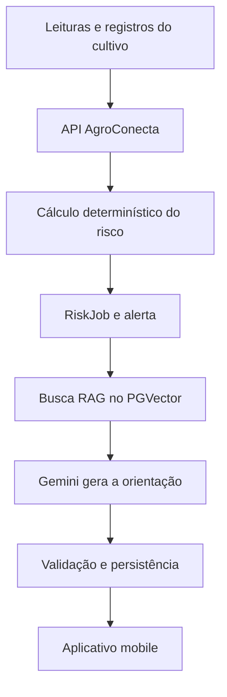

# AgroConecta

Aplicativo mobile para acompanhamento de propriedades rurais, monitoramento hídrico e apoio à tomada de decisão de pequenos produtores.

## Links da entrega

| Recurso | Link |
| --- | --- |
| Repositório mobile |  |
| Repositório da API | [GS-FINAL](https://github.com/deryksouza2006/GS-FINAL) |
| API publicada |  |
| Vídeo de apresentação |  |

## Integrantes

| Nome | RM |
| --- | --- |
|  |  |
|  |  |
|  |  |
|  |  |

## Sobre a solução

O AgroConecta foi desenvolvido para facilitar o acompanhamento de cultivos por pequenos produtores rurais. A solução reúne informações que normalmente ficariam espalhadas — propriedades, talhões, sensores, leituras, atividades agrícolas, alertas e análises — em um único aplicativo.

O objetivo é transformar medições e registros do campo em informações mais compreensíveis, ajudando o produtor a identificar riscos hídricos e consultar orientações contextualizadas. O sistema oferece apoio informacional e não substitui a avaliação de um engenheiro agrônomo.

## Principais funcionalidades

- Cadastro e autenticação segura com JWT.
- Cadastro, consulta, edição e exclusão de propriedades rurais.
- Gerenciamento de talhões, incluindo transferência, arquivamento e reativação.
- Diário agrícola com registros de irrigação, fertilização, plantio e colheita.
- Perfil agronômico por talhão.
- Cadastro e acompanhamento de sensores.
- Registro manual e consulta do histórico de leituras.
- Identificação de dados simulados e demonstrativos.
- Consulta da saúde e da comunicação dos sensores.
- Dashboard com visão geral da propriedade e do cultivo.
- Análise determinística de risco hídrico.
- Alertas com reconhecimento e resolução.
- Orientação agronômica contextual gerada por IA.
- Exibição das fontes utilizadas pela orientação.
- Temas claro, escuro e de acordo com o sistema.

## Inteligência artificial e RAG

O nível de risco hídrico é calculado por regras determinísticas no backend Java. A IA não pode alterar essa classificação: sua função é explicar o resultado e apresentar recomendações, ações, avisos e fontes de consulta.

A API utiliza o Gemini para geração de texto e RAG com PostgreSQL e PGVector. Antes da geração, o sistema recupera conteúdos de um corpus agronômico baseado em referências da Embrapa e da FAO. A orientação válida é persistida e reutilizada; quando o provedor não está disponível, o aplicativo apresenta uma contingência claramente identificada.



A chave do Gemini pertence exclusivamente ao ambiente da API e nunca é armazenada no aplicativo mobile.

## Tecnologias

### Mobile

- Node.js 22 e npm.
- Expo SDK 58 (`~58.0.25`).
- React Native 0.88.1 e React 19.3.
- TypeScript.
- React Navigation.
- TanStack Query.
- Axios.
- Expo SecureStore.

### Backend integrado

- Java 21 e Spring Boot.
- Spring Security e JWT.
- PostgreSQL e PGVector.
- RabbitMQ e Transactional Outbox.
- Spring AI e Gemini.
- Flyway e Docker.

## Arquitetura do mobile

O aplicativo está organizado por responsabilidade. As telas utilizam hooks, que acessam o cache e os serviços responsáveis pela comunicação com a API.

```text
Screen → Hook → TanStack Query → Service → Axios → API
```

O JWT é armazenado no SecureStore. As rotas protegidas somente são liberadas depois da validação da sessão pela API. Erros de rede preservam a sessão para uma nova tentativa, enquanto respostas de autenticação inválida removem o token e limpam o cache.

## Execução

### Pré-requisitos

- Node.js 22.
- npm.
- Expo Go compatível com SDK 58 ou development build.
- API AgroConecta disponível local ou remotamente.

### Configuração

Crie o arquivo `.env` a partir do exemplo do projeto:

```env
EXPO_PUBLIC_API_URL=http://IP_DA_API:8080
EXPO_PUBLIC_COMMIT_HASH=
```

`EXPO_PUBLIC_API_URL` deve conter somente a origem da API, sem `/api` no final. Variáveis `EXPO_PUBLIC_*` ficam acessíveis no aplicativo e não devem receber senhas, tokens ou chaves privadas.

### Instalação e inicialização

```bash
npm install
npx expo start
```

Com o celular e o computador na mesma rede, leia o QR Code pelo Expo Go. Em um emulador Android, a API local pode ser acessada por `http://10.0.2.2:8080`.

## Verificações do projeto

```bash
node --test tests/*.test.mjs
npx tsc --noEmit
npx expo install --check
```

Estado validado da entrega mobile:

- 105 testes aprovados.
- TypeScript sem erros.
- Dependências compatíveis com o Expo SDK 58.

## Limitações conhecidas

- Não existe integração com ESP32 físico nesta versão.
- Não há comunicação MQTT nem utilização de dados de satélite.
- As leituras disponíveis são registradas manualmente ou produzidas pela simulação controlada do backend.
- A saúde dos sensores utiliza uma política demonstrativa e não equivale a um diagnóstico físico do equipamento.
- A disponibilidade da orientação depende da API, da rede e do provedor de IA.
- Os parâmetros agronômicos são demonstrativos e devem ser confirmados por um profissional.

## Relação com os ODS

- **ODS 2 — Fome zero e agricultura sustentável:** amplia o acesso do pequeno produtor a informações de apoio ao cultivo.
- **ODS 9 — Indústria, inovação e infraestrutura:** integra dados, serviços digitais, mensageria e inteligência artificial.
- **ODS 13 — Ação contra a mudança global do clima:** apoia a interpretação de condições hídricas e a adaptação do manejo.

## Repositório da API

O cálculo de risco, os alertas, a persistência, a mensageria, o RAG e a integração com o Gemini estão implementados no backend:

**[github.com/deryksouza2006/GS-FINAL](https://github.com/deryksouza2006/GS-FINAL)**
